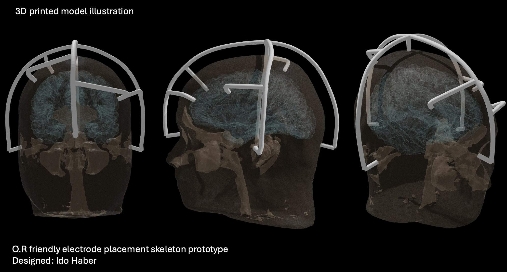
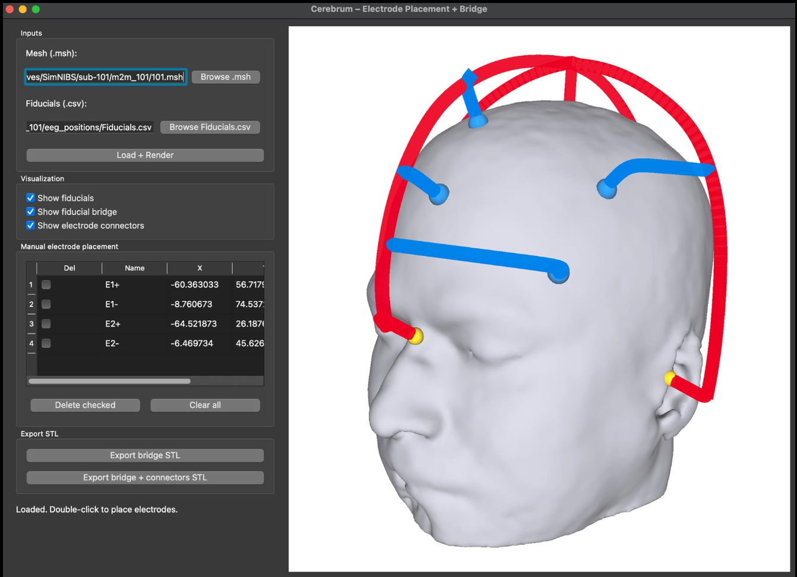

# Cerebro

A software–hardware solution for precise EEG electrode placement.

## Overview

A software-hardware solution that gives users a straightforward, robust solution for
accurate placement of electrodes on a subject's scalp. It is especially helpful when
electrode positions for complex and sensitive paradigms were computationally optimized
and require millimeter-resolution accuracy during placement, or repetitive placement
across multiple sessions.

## Process

Experimentation was done on the software end with different approaches when it came to
GUI design, UI/UX, and interaction of user input. Further exploration was done when it
came to print material using Bambu Studio (TPU vs PLA), with iterations on orientation,
supports, and nozzle choices to improve print quality, efficiency, and cost.

## Current State

Software is still in late stages of development and is currently closed source but can
potentially be provided upon request. Prints are stable and can be done in one piece
over three hours given sufficient print bed size.

## Print Timelapse

<video controls preload="metadata" playsinline style="width:100%;border-radius:6px;margin-top:0.5rem">
  <source src="/assets/projects/cerebro/3D_timelapse.mp4#t=0.1" type="video/mp4">
</video>
