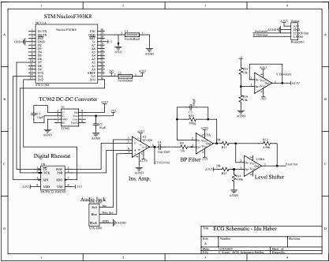
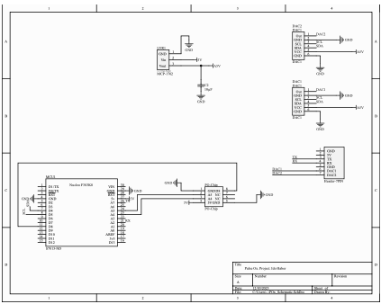
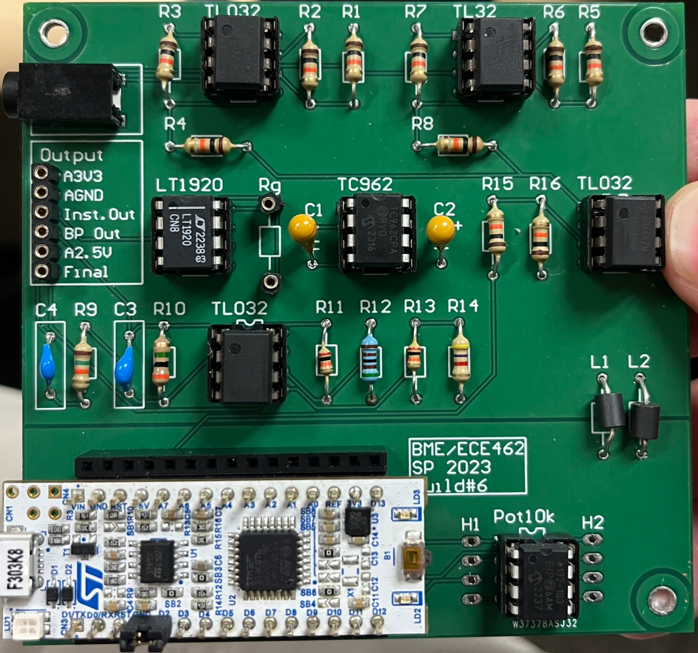

# Bioinstrumentation ECG

ECG + pulse oximetry system design, testing, and results.

## Summary

End-to-end ECG + pulse oximetry build: analog front end, filtering, acquisition, and
validation — from schematic design through a fabricated PCB to a captured signal trace.

## Schematics

**ECG front end**

**Pulse oximetry front end**

## Fabricated board

## Signal capture

<video controls preload="metadata" playsinline style="width:100%;border-radius:6px;margin-top:0.5rem">
  <source src="/assets/projects/ECG/ECG_signal.mp4#t=0.1" type="video/mp4">
</video>
