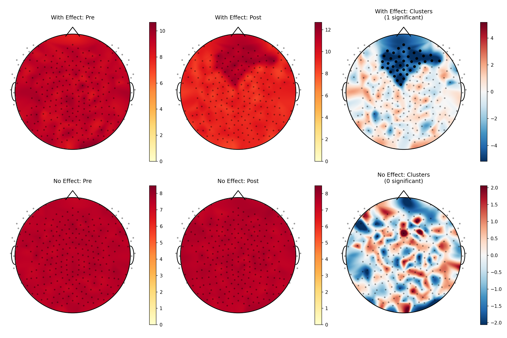

# EEG Topographic Analysis

A Python package for EEG topographic mapping and cluster-based permutation testing.

## Overview

`eegtopo` is a pip-installable Python package designed for creating publication-quality
topographic maps and performing cluster-based permutation testing on EEG data. It
features a simple DataFrame interface — just bring your data, no complex setup required.

## Key Features

- **Publication-quality topographic maps** with customizable colormaps and head outlines
- **Cluster-based permutation testing** with automatic spatial adjacency detection
- **Simple DataFrame interface** compatible with pandas
- **Support for multiple montages** including standard 10-20, EGI 128/256, and custom configurations
- **Significance highlighting** overlaid on topographic maps

## Example Results



*Top row: Dataset with significant frontal alpha effect (GSN-HydroCel-256). Bottom row:
Null data showing no significant clusters.*

## Installation & Usage

Installation:

```
pip install eegtopo
```

Quick start:

```python
import pandas as pd
from eegtopo import TopographicAnalysis, run_cluster_analysis

# Your data - just needs subject, channel, value, and condition columns
df = pd.DataFrame({
    'subject': ['sub-01', 'sub-01', 'sub-02', 'sub-02', ...],
    'channel': ['E1', 'E1', 'E1', 'E1', ...],
    'condition': ['pre', 'post', 'pre', 'post', ...],
    'power': [1.2, 2.3, 1.1, 2.1, ...]
})

# Method 1: One-shot analysis
results = run_cluster_analysis(
    df,
    condition_a='pre',
    condition_b='post',
    value_col='power',
    plot=True,
    save_path='results.png'
)

print(f"Found {results['results'].n_sig_clusters} significant clusters")
print(results['results'].summary())
```

## References

This package implements methods described in the following key publications on
cluster-based permutation testing and EEG topographical analysis:

- Maris, E., & Oostenveld, R. (2007). Nonparametric statistical testing of EEG- and MEG-data. *Journal of Neuroscience Methods*, 164(1), 177-190. <https://doi.org/10.1016/j.jneumeth.2007.03.024>
- Pernet, C. R., Latinus, M., Nichols, T. E., & Rousselet, G. A. (2015). Cluster-based computational methods for mass univariate analyses of event-related brain potentials/fields: A simulation study. *Journal of Neuroscience Methods*, 250, 85-93. <https://doi.org/10.1016/j.jneumeth.2014.08.003>
- Oostenveld, R., Fries, P., Maris, E., & Schoffelen, J. M. (2011). FieldTrip: Open source software for advanced analysis of MEG, EEG, and invasive electrophysiological data. *Computational Intelligence and Neuroscience*, 2011, 156869. <https://doi.org/10.1155/2011/156869>

[View on GitHub →](https://github.com/idossha/eegtopo)
