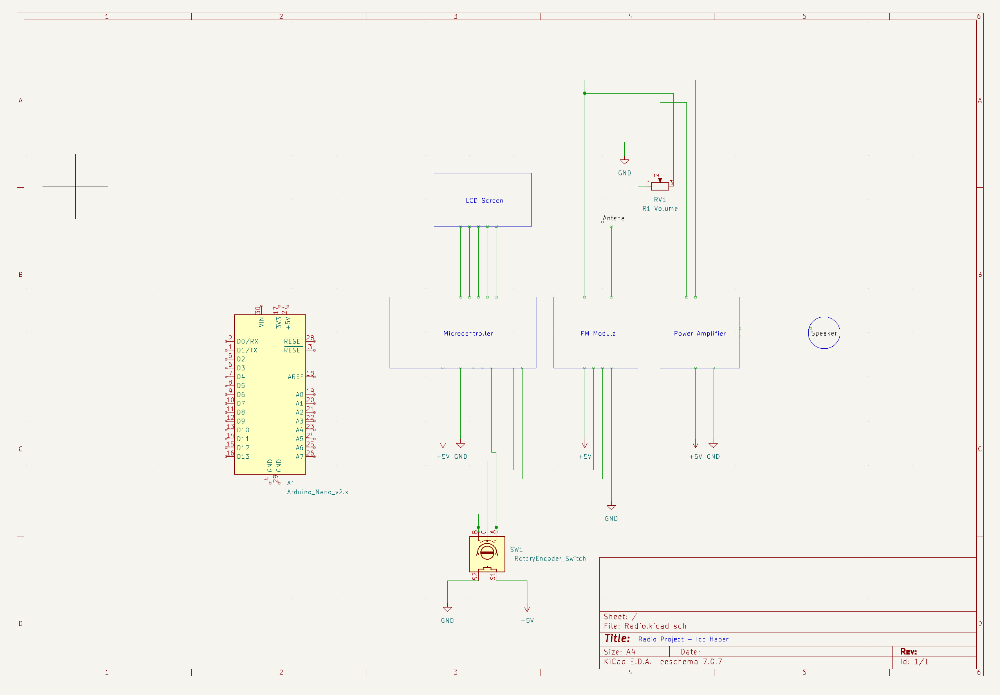

# Radio

An Arduino-based FM radio receiver, designed in KiCad and built as a working
prototype.

## Design

The radio is built around an Arduino Nano microcontroller driving an FM receiver
module. A rotary encoder with a push switch handles tuning and selection, an LCD
screen displays station and status, and a potentiometer sets the volume. The
demodulated audio is driven through a power amplifier stage into a speaker, with a
wire antenna feeding the FM module. The whole system runs off a single 5 V rail.

## Demo

<video controls preload="metadata" playsinline style="width:100%;border-radius:6px;margin-top:0.5rem">
  <source src="/assets/projects/radio/radio-1.mp4#t=0.1" type="video/mp4">
</video>

<video controls preload="metadata" playsinline style="width:100%;border-radius:6px;margin-top:0.5rem">
  <source src="/assets/projects/radio/radio-2.mp4#t=0.1" type="video/mp4">
</video>
