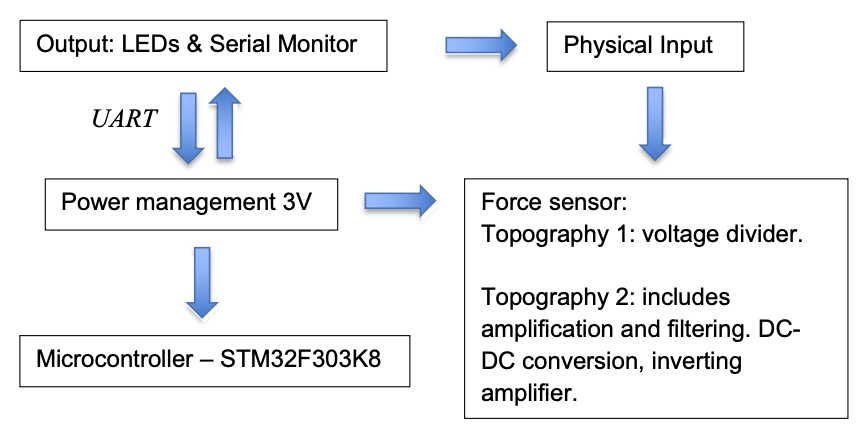
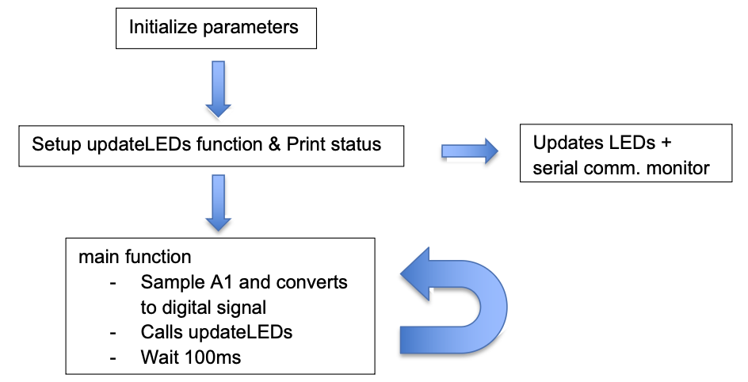
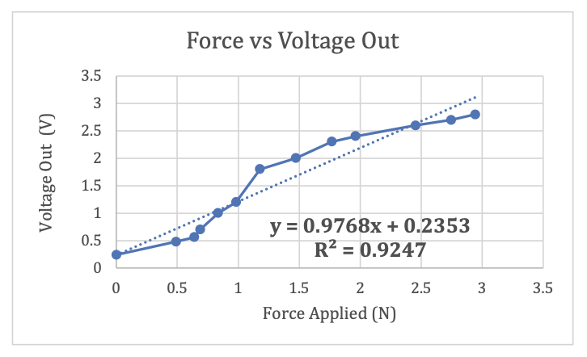

# Robotic Arm — Force Sensitive

_Sensor Design Project (BME 462), December 2023._

A force-sensitive robotic arm designed to assist remote operators during
robot-assisted surgeries by making the tool sensitive to the force applied on
tissue. The project covers FDA classification, hardware and software design, and
verification and validation of device operation.

## Motivation

Robot-assisted surgeries such as the da Vinci system operate in a master/slave
configuration, where a remote operator controls the tool. These systems offer
miniature tooling, stability, and precision, but without a proper feedback loop the
robotic arm cannot sense how much force is exerted on the manipulated tissue.
Mounting a force sensor gives the operator a sense of the tool–tissue interaction.
This project builds a crude prototype using a simple plier, a sensing circuit, and
C++ code in the MBED environment. Under the FDA's device classification, endoscopic
robotic arms fall under Class II.

## Hardware

The system reads a force sensor through one of two topographies — a simple voltage
divider, or an amplified and filtered path with DC-DC conversion and an inverting
amplifier — powered at 3 V and read by an STM32F303K8 microcontroller, which drives
LED and serial-monitor feedback over UART.

## Software

The MBED program initializes parameters, sets up an `updateLEDs` function, then
loops: sampling the analog force input, converting it to a digital signal, updating
the LEDs, and waiting 100 ms before repeating.

## Verification & Validation

Calibrating force against output voltage produced a linear response with a
resolution of ~0.97 V/N and an R² of 0.92, giving confidence in accurate readings
within the calibrated range. For the amplified topography, a 300 pF capacitor in
parallel with a 10 kΩ resistor set the amplification and a low-pass filter to remove
high-frequency noise that might confound the feedback.

Against the design requirements the device achieved 92.5% accuracy with high
versatility across different sensing ranges, provided visual feedback via colored
LEDs and serial communication, and — thanks to the UART protocol — allowed sensing
data to be recorded for later comparison with surgical outcomes. Based on the force
typically exerted during retraction and grasping in general surgeries, the system
targets the 1–3 N range for high-sensitivity feedback.

## Demo

<video controls preload="metadata" playsinline style="width:100%;border-radius:6px;margin-top:0.5rem">
  <source src="/assets/projects/robotic_arm/robotic_arm.mp4#t=0.1" type="video/mp4">
</video>

## Conclusion

From testing and validation, these force sensors are strong candidates for a
precise, reliable source of information about forces exerted on objects. Each step —
from the mathematical approach to LTspice simulation to physical testing — behaved
as expected. Malleable objects and non-flat sensor profiles complicate the reading
and would warrant further characterization, and additional force sensors across more
degrees of freedom could yield more comprehensive data collection.

[Download the full report (PDF)](/assets/projects/robotic_arm/robotic_arm_final.pdf)
